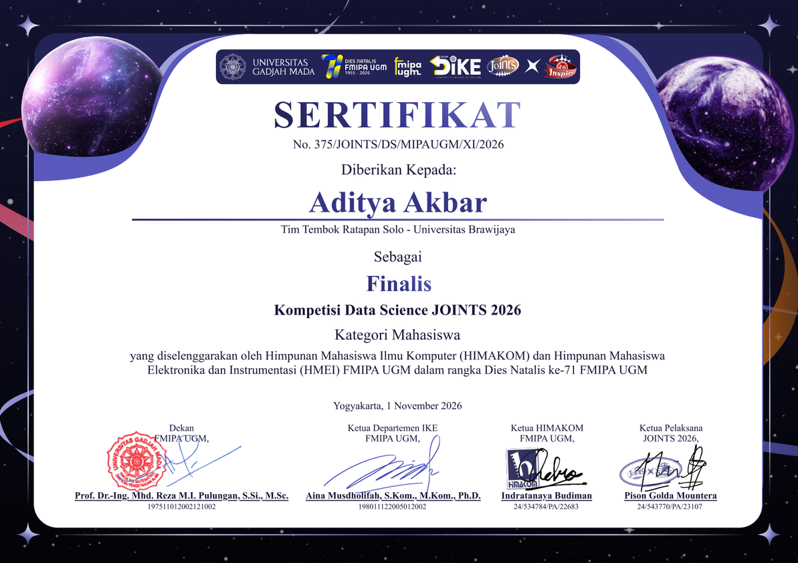
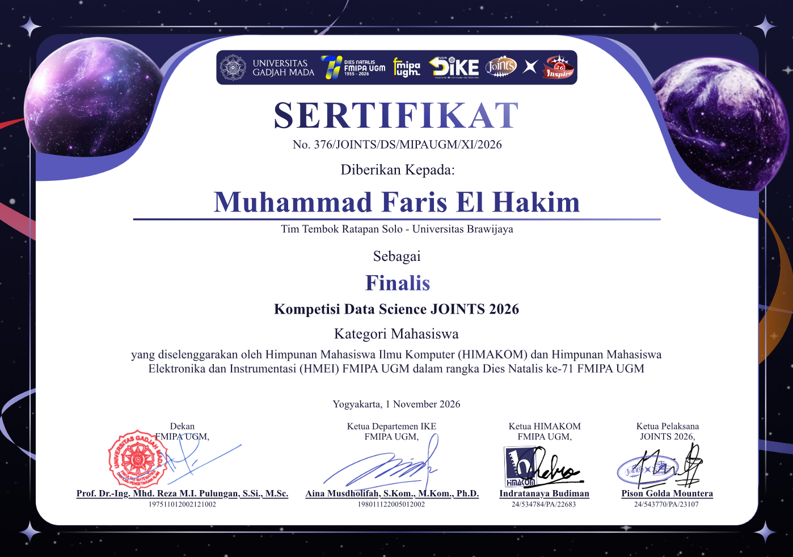
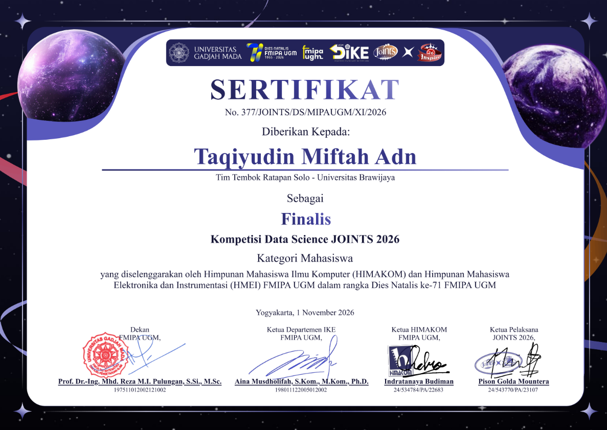
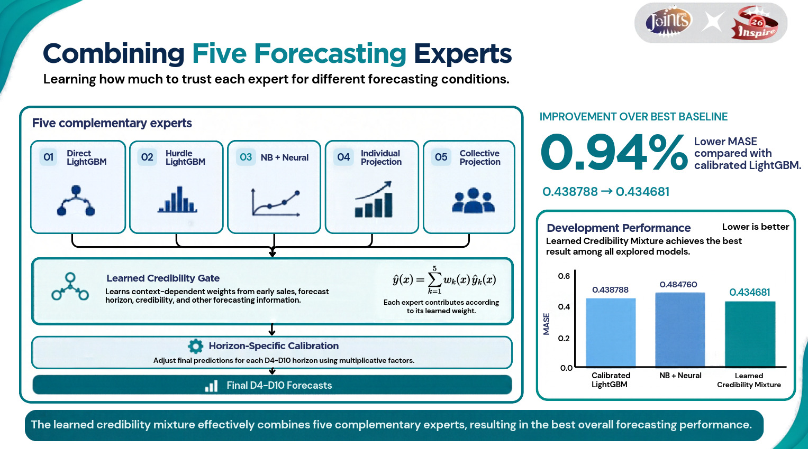

# Tembok Ratapan Solo — JOINTS 2026 Movie-Ticket Forecasting

## Achievement

  
  
  

**Tembok Ratapan Solo was a finalist in the student category of the JOINTS 2026 Data Science Competition.** The team is Aditya Akbar, Muhammad Faris El Hakim, and Taqiyudin Miftah Adn of Universitas Brawijaya.

## Project at a Glance

This project forecasts ticket demand for movie–cinema pairs over days 4–10 (D4–D10), using only information available in the first three days (D1–D3). The technical report investigates how actuarial structure, statistical count models, gradient-boosted trees, and neural correction can be combined for this short-history, multi-horizon setting.

The main model is a **learned credibility mixture of five forecasting experts**. Each expert uses a different source of information: pair-specific opening behavior, zero-versus-positive demand, a Negative Binomial prior, or patterns pooled across films and cinemas. A small gate learns how much to trust each expert from earlier out-of-fold predictions and the context of the forecast.

The repository contains the report notebook, three finalist certificates, the pipeline illustration, and reproduction instructions. It does not contain the competition data or saved model package; see [Reproducibility](REPRODUCIBILITY.md) before trying to run the inference cells.

## Forecasting Task

A prediction row represents a movie, cinema, and target date. The notebook builds one forecast window per movie–cinema pair and predicts its seven target days, D4 through D10. The target is `total_ticket`. The first three days provide the opening level and early trajectory, but the forecast must continue beyond those observed days without using future ticket counts.

The competition's scaled absolute-error metric is calculated as:

`MASE = mean(abs(actual_total_ticket - predicted_total_ticket) / opening_scale)`

where `opening_scale` is the mean ticket count over D1, D2, and D3, floored at 1. This makes errors comparable across small and large openings and gives the model a reason to perform well on low-volume titles as well as blockbusters. Lower MASE is better.

Demand can change for several reasons. A film may open at different cinemas on different dates, daily counts may be zero, and early demand may rise or fall. Ticket counts also differ greatly by film and cinema. The notebook therefore retains pair-level opening information while borrowing strength from broader historical patterns. It treats a missing transaction according to the competition's target-grid contract rather than assuming every absent row is an arbitrary missing value.

## Five Forecasting Experts

The five experts are designed to make different kinds of forecasts. They are trained and combined within Approach 3, the learned credibility mixture. Two are LightGBM heads, one is the neural correction from Approach 2, and two are transparent actuarial projections.

### 1. Direct LightGBM

The direct expert learns a ticket forecast from the engineered film, cinema, opening, calendar, and actuarial features. Instead of predicting the raw ticket count directly, it predicts a ratio relative to an actuarial reference forecast:

`ratio = total_ticket / reference`

The final ticket forecast is the predicted ratio multiplied by that reference. Training uses an L1 objective and a sample weight proportional to `reference / opening_scale`. This weighting makes the tree's absolute-error training objective align with the competition's scaled error. The direct model can use examples with zero or positive ticket counts; it does not explicitly split the task into separate zero and positive processes.

This expert is useful when the feature interactions are informative—for example, when the effect of a D1-to-D3 trend differs by forecast horizon, cinema, genre, or opening size. Its output is clipped to remain non-negative.

### 2. Hurdle LightGBM

The hurdle expert explicitly models the distinction between a zero outcome and a positive outcome. It has two parts:

1. A binary LightGBM classifier estimates the probability that the target is zero.
2. A bank of LightGBM quantile regressors estimates several points in the positive-ticket distribution, using only positive training targets.

These estimates are combined to obtain a median forecast, which is appropriate for an absolute-error objective. If the estimated probability of zero is at least 0.5, the mixture median is zero. Otherwise, the expert selects the positive-ticket quantile needed for the overall median. The quantile predictions are made monotonic before interpolation so that their ordering remains valid.

This design can represent a high chance of no tickets without forcing the same tree to fit zeros and the heavy-tailed positive counts with one regression surface. It is still a point forecast: the classifier and quantiles are components used to derive the median, not a claim that the full predictive distribution is calibrated.

### 3. Negative Binomial + Neural Correction (CANN)

The third expert starts with a statistical count-model prior, then applies a learned nonlinear correction. A regularized Negative Binomial GLM uses a log link and an offset based on the actuarial reference. It also uses donor-fitted encodings for categorical variables and standardized numeric features. The Negative Binomial dispersion is estimated from the training fold.

A neural network with hidden layers of 64 and 32 units predicts a multiplicative adjustment:

`prediction = NegativeBinomial_prior * exp(neural_correction)`

The final layer begins at zero, so the network initially reproduces the prior exactly. Training then adjusts it using the competition's scaled absolute-error loss. A chronological inner holdout with film separation selects the training duration before the network is refit on the available donor rows. The uncorrected Negative Binomial prior is retained as an ablation in the report.

This expert combines a structured, positive count-model baseline with nonlinear feature interactions. Because its network is optimized for a point forecast, the result should not be interpreted as a calibrated Negative Binomial mean or interval.

### 4. Individual Projection

The individual projection uses the recent behavior of the particular movie–cinema pair. It starts from a level that averages the D3 count with the pair's opening scale, then estimates a bounded trend from the D1-to-D3 change. That trend is extrapolated with damping and stops accumulating after the first few forecast horizons:

`level = 0.5 * ticket_d3 + 0.5 * opening_scale`

`slope = clip(log((ticket_d3 + 1) / (ticket_d1 + 1)) / 2, -0.35, 0.35)`

`forecast = max(level * exp(slope * min(horizon, 3) * 0.35), 0)`

The projection keeps the pair's own opening behavior in the forecast while limiting the influence of a noisy two-point trend. It does not recursively feed its own predictions into later days. After the initial trend adjustment, it avoids letting that trend grow without bound across D4–D10.

### 5. Collective Projection

The collective projection borrows information from other historical movie–cinema pairs. It begins with the current pair's opening scale and multiplies it by a horizon-specific development profile. The profile is built from historical median ticket-to-opening-scale ratios. Genre and cinema factors adjust that profile when those groups have supporting examples.

Sparse genre and cinema estimates are shrunk toward a neutral factor of 1. As the number of supporting observations grows, the group factor contributes more; with little evidence, the projection falls back toward the overall development curve. The expert therefore gives a stable pooled forecast when an individual pair has little reliable history. The projection does not use film ID or title as a routing key.

## How the Credibility Gate Combines the Experts

For each row, the gate receives context about the forecast horizon, opening scale, history coverage, how late the pair appeared, ticket variability, D1-to-D3 ticket change, show change, occupancy change, and actuarial credibility. It also receives expert disagreement, measured as the spread among the experts' forecasts after dividing by opening scale.

A small neural network with one 32-unit hidden layer converts this context into five weights using softmax. Consequently, each weight is non-negative and the weights sum to one:

`mixture_forecast = w_direct * direct + w_hurdle * hurdle + w_cann * cann + w_individual * individual + w_collective * collective`

The weights can change with the row's available information. For example, pair-specific projections may be more useful when an opening trajectory is clear, while the collective expert can provide a steadier reference when pair history is sparse. These are learned weights, however; the model does not apply hand-written rules such as “always use expert X for genre Y.”

To keep the gate from seeing its own evaluation labels, it learns from out-of-fold expert predictions whose target periods have already ended. The current fold and its held-out films are excluded from gate history. When fewer than 200 earlier out-of-fold rows are available, the warm-up weights are fixed at 15% direct, 45% hurdle, 20% CANN, 10% individual, and 10% collective. The report also compares the learned gate with a static convex blend.

After expert combination, a separate multiplicative calibration factor is estimated for each forecast horizon from earlier out-of-fold predictions. The factor uses a weighted median ratio and is shrunk toward 1 when the available history is limited. This lets D4 and D10 receive different adjustments without using the fold currently being scored.

## Features, Data Boundaries, and Validation

The feature set combines D1–D3 ticket, show, occupancy, and observed-status information with opening scale, pair age, first-seen timing, genre, cinema, city, movie format, ticket price, weekday, weekend, and holiday context. Actuarial features summarize horizon development and group-level credibility. The notebook also checks transaction-grid zeros, staged openings, heavy-tailed scale, and train–test shift before evaluating the models.

External historical context is kept separate from target labels. The notebook checks publication and availability timestamps against the September 30, 2025 cutoff, ranks values only within the same source, metric, and reporting period, and shrinks genre signals. The signal enters through `0.95 + 0.05 × signal`, giving it a 5% blend weight against a neutral value. The recorded source coverage is small and does not directly match test titles, so the external signal is treated as supplementary context rather than ground truth.

Development evaluation uses five chronological monthly folds from May through September 2025. Each fold trains on donor windows whose full target horizon ended before the fold begins, and excludes the validation films from donor history. The gate and horizon calibration use earlier out-of-fold predictions only. The report also records seed comparisons, per-fold scores, ablations, uncertainty summaries, and diagnostics for zeros, horizon, opening scale, and film groups.

## Development Results

| Approach | Pooled development MASE |
| --- | ---: |
| Actuarial features + LightGBM | 0.438788 |
| Negative Binomial prior + neural correction | 0.484760 |
| Learned credibility mixture | **0.434681** |

On this development comparison, the learned mixture's MASE is about **0.94% lower** than the calibrated LightGBM result (0.438788 to 0.434681). The five-expert mixture has a small pooled improvement, but the report also shows fold-level variation and cases where an individual expert performs better. The scores should be read together with the validation protocol and limitations below.

The values above are saved results from the notebook's earlier clean training runs. The published notebook loads model state for inference; running it does not repeat those training runs or the original search. These are development scores, **not hidden-test scores or evidence of a final leaderboard position**.

## Interpretability and Limitations

The ensemble's expert weights and forecast components make its combination inspectable: the mixture prediction can be reconstructed directly as the weighted sum of expert predictions. TreeSHAP in the notebook explains the direct LightGBM component only; it is not a complete attribution for the hurdle model, neural correction, or the whole learned mixture. The report checks that the TreeSHAP values reconstruct the direct tree prediction, but these contributions should not be interpreted as causal effects.

Several limits matter when interpreting the results:

- Five development months provide a short history, and repeated exploration can introduce model-selection bias even with chronological folds.
- Movie demand and cinema availability vary by title, city, and date; pooled MASE does not guarantee that every subgroup improves.
- Zero ticket counts follow the competition's grid contract, but the data do not identify the operational cause of each zero.
- Group-level and external histories are incomplete. Shrinkage and fallbacks stabilize predictions, but cannot create evidence for an unseen category.
- The final compact routing configuration described in the notebook was selected adaptively. Its agreement diagnostics are not an independent generalization estimate, and its result must not be substituted for the five-fold development score.
- No hidden-test or leaderboard result is included in this repository.

## Reproducing the Technical Report

The notebook's inference path expects the official competition ZIP, packaged model state, and two auxiliary CSV files. Those files are not included in this repository. The notebook produces 72,611 predictions in official sample-submission ID order once the required inputs are supplied. It records input and output hashes in an inference receipt and checks the submission schema, ID uniqueness, row order, and finite non-negative predictions.

See [REPRODUCIBILITY.md](REPRODUCIBILITY.md) for the Python environment, exact input filenames, local data placement, and run instructions.

| Path | Description |
| --- | --- |
| [notebook/Tembok Ratapan Solo.ipynb](notebook/Tembok%20Ratapan%20Solo.ipynb) | Indonesian technical report, recorded development results, and inference-only workflow. |
| [assets/](assets/) | Three finalist certificates and the five-expert pipeline illustration. |
| [datasets/](datasets/) | Local-only location for competition and auxiliary inputs; data are not versioned. |
| [REPRODUCIBILITY.md](REPRODUCIBILITY.md) | Environment, input contract, and run instructions. |
| [requirements.txt](requirements.txt) | Pinned Python dependencies matching the notebook setup cell. |
